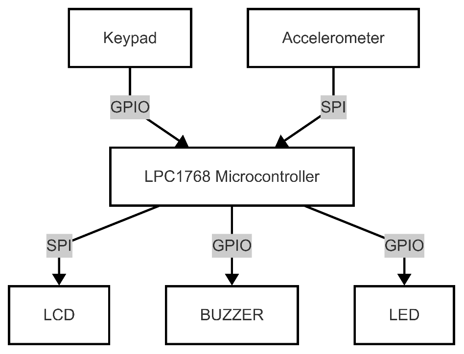
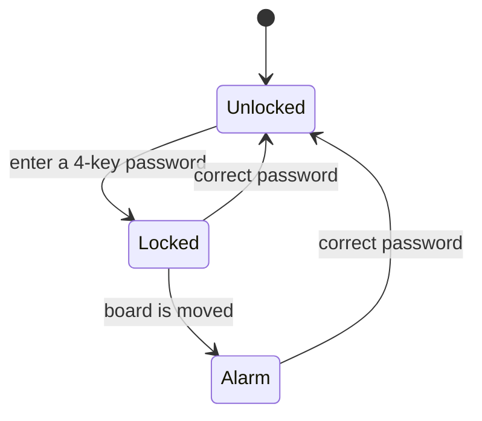

# Robbery Alert System (LPC1768)

An embedded anti-theft alarm built on the **mbed LPC1768** (ARM Cortex-M3). You lock it with a password on a keypad. If anyone moves it while it is locked, an accelerometer detects the movement and a buzzer and red LED go off until the correct password is entered.

Course project for COE 306 (Embedded Systems) at KFUPM.

  

## How it works

1. At startup the LCD shows **Unlocked**.
2. Entering a 4-key password saves it, records the current accelerometer reading, and locks the system (LCD shows **Locked**).
3. While locked, the accelerometer is read continuously. If the sum of the X, Y and Z readings changes by more than 50 (about 0.2 g at the ADXL345's default range), the buzzer and LED turn on.
4. The alarm keeps going until the same password is entered. Then the system unlocks. A wrong password changes nothing.

## Hardware

| Component | Purpose | Interface |
|---|---|---|
| mbed LPC1768 | Main controller | - |
| ADXL345 accelerometer | Detects movement | SPI (SSP0) |
| 3x4 matrix keypad | Password input (0-9, *, #) | GPIO |
| Nokia 5110 LCD | Shows Locked / Unlocked | SPI |
| Buzzer + red LED | Alarm | PWM |

### Wiring

| Part | Signal | mbed pin | LPC1768 pin |
|---|---|---|---|
| Nokia 5110 LCD | DIN / CLK / CE / RST / DC | p5 / p7 / p8 / p9 / p10 | P0.9 / P0.7 / P0.6 / P0.0 / P0.1 |
| ADXL345 | MOSI / MISO / SCLK / CS | p11 / p12 / p13 / p14 | P0.18 / P0.17 / P0.15 / P0.16 |
| Keypad rows | R1 / R2 / R3 / R4 | p23 / p28 / p27 / p25 | P2.3 / P0.10 / P0.11 / P2.1 |
| Keypad columns | C1 / C2 / C3 | p24 / p22 / p26 | P2.2 / P2.4 / P2.0 |
| Buzzer and LED | PWM1.6 | p21 | P2.5 |

## Code overview

Everything is in [`main.cpp`](main.cpp). Most peripherals are driven through the LPC1768 registers directly; the mbed library is used for the LCD driver and delays.

| Part | What it does |
|---|---|
| `main()` | Sets up the keypad pins and the GPIO interrupt, then loops: handles password entry and, while locked, checks the accelerometer. |
| `EINT3_IRQHandler()` | GPIO interrupt that sets a flag to start password entry. |
| `get_password()` / `scan_keypad()` | Reads 4 keys by driving one keypad row low at a time and reading the columns. |
| `read_accelerometer()` / `adxl345_read()` | Configures SSP0 as SPI, puts the ADXL345 in measurement mode, and reads the X, Y and Z registers. |
| `buzzer()` / `led()` | Start or stop the PWM1.6 output that drives the buzzer and LED. |

## Build and run

1. Create an Mbed project for the **mbed LPC1768** board.
2. Add the `mbed` library and the `TextLCD_NOKIA_5110` library (Nokia 5110 LCD driver).
3. Replace the project's `main.cpp` with the one in this repo and compile.
4. Copy the generated `.bin` file to the board's MBED USB drive and press reset.

Debug messages (key presses and accelerometer values) are printed over the USB serial port.

## Limitations and future work

- Movement is detected from the sum of the three axes, so slow movement, or a rotation where one axis increases while another decreases, can go unnoticed.
- The password is kept in RAM and is lost on power-off, and there is no limit on wrong attempts.
- Future ideas: SMS alerts via a GSM module, and GPS tracking of the protected item.

## Authors

- Thamer Alotaibi
- Abdulaziz Ashy
